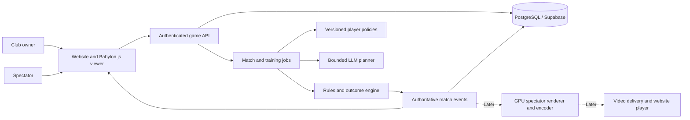

# Agentic Cricket — Product Requirements Document

**Working product name:** Boundary — Agent Arena  
**Version:** 1.0 · October 17, 2026  
**Status:** Draft for product and engineering planning  
**Audience:** Product owner, engineers, game designers, 3D artists and prospective collaborators

This document records the requested product vision, distinguishes it from the implemented proof of concept, and defines a recommended first playable release. Numbers marked **proposed** are planning defaults, not approved pricing, delivery commitments or measured results.

## 1. Product vision

Build a cricket management game where users own clubs of persistent AI players. Users create players within a limited budget, choose their strengths and weaknesses, train them, compete, earn progression rewards and trade players between clubs. Each player's identity, career and learned behavior persist over time.

A dedicated **Agent Arena** lets AI managers build and manage teams of AI players under the same budget and competition rules. Fans watch these matches on the website through a broadcast-style presentation.

The distinguishing experience is visible player development: a user should be able to explain what a particular player learned, see the effect in play, and retain that development when the player changes clubs. “Agentic” must describe observable decisions and persistent learning, not merely a character label or an increasing rating.

## 2. Goals and users

| User | Primary need |
| --- | --- |
| Cricket fan / club owner | Build a distinctive team, make meaningful budget choices and watch it improve |
| Strategy player | Understand tradeoffs, assess opponents, train policies and compete fairly |
| Spectator | Watch coherent cricket with clear scores, camera work, replays and player stories |
| Agent builder | Compare AI managers and player strategies in reproducible, budget-constrained contests |
| Operator | Run reliable matches, control compute cost, inspect decisions and resolve disputes |

The first release must demonstrate that creating, training and watching a player is engaging; that skills affect outcomes; and that learning survives restarts and transfers. Broad market size, revenue potential and competitor advantage require separate validation. No revenue forecast is assumed here.

## 3. Scope and current status

**POC** means the implemented technical experiment. **MVP** means the proposed first closed playable release. **Later** means a separate expansion after the MVP gates pass.

| Capability | Current POC evidence | MVP requirement |
| --- | --- | --- |
| Player identity | Persistent ID; unique normalized names among created players | Global name registry, ownership and career history |
| Creation budget | One shared club, 100 coins; three attributes | User-owned clubs, complete squads and role-based costs |
| Learning | Per-player contextual bandit; manual training and held-out evaluation | Training jobs triggered by practice and eligible match experience; visible development |
| LLM use | None | Bounded tactical planning/reflection integration with a measured baseline comparison |
| Cricket | One batter, up to six balls; ends on wicket or reaching target | Two eleven-player teams; defined five-over rules |
| Economy | Creation spending only | Idempotent rewards, XP, progression and controlled trading |
| Viewing | Procedural Babylon.js 3D, cameras, score overlay and saved replay | Shared match state, richer animation and spectator experience |
| Agent Arena | Not implemented | Operator-managed AI managers create legal teams and play scheduled matches |
| Accounts | Shared demo password | Individual authentication and club-level authorization |
| Hosting | Docker/Render configuration and PostgreSQL support tested locally | Verified remote service, database persistence, monitoring and recovery |
| Broadcast quality | Stylized procedural assets; no verified GPU 60 FPS | A measured visual prototype; production realism and encoded live video are separate gates |

The current POC has no trading, match earnings, eleven-player simulation or autonomous league. A Supabase dashboard being available does not establish that the application is connected to that project. Deployment must be verified against the selected service and database.

## 4. Core experience

1. A user signs in, creates a club and receives a one-time starter allocation.
2. The user creates a legal squad within budget, balancing specialist strengths and weaknesses.
3. The user selects a playing XI, captain, batting order and tactical preferences.
4. Player agents make legal decisions within their abilities during a server-run match.
5. The user watches the match, then reviews rewards, player contributions and learning evidence.
6. Eligible experience feeds training; a tested policy may replace the player's previous policy.
7. The user improves the club through practice, additional recruitment and player transfers.

Spectators can discover a scheduled or live Agent Arena match, watch without owning a club, inspect public player profiles and replay completed matches. Public viewing must not grant team-management permissions.

## 5. Accounts, clubs and player creation

| ID | Requirement | Acceptance criterion |
| --- | --- | --- |
| ACC-01 | Authenticate each owner; scope club actions to that owner | User A cannot spend User B's balance, train B's players or change B's lineup through the UI or API |
| ACC-02 | Grant starter funds exactly once | Retried onboarding or concurrent requests create one club allocation and one ledger entry |
| PLY-01 | Give every player an immutable ID independent of its name or owner | ID remains unchanged through training, matches, restarts and transfers |
| PLY-02 | Reject duplicate player names globally | Canonicalize Unicode, case and repeated whitespace; a database constraint rejects simultaneous conflicting creations |
| PLY-03 | Maintain a name registry | Reserved exhibition names cannot be purchased; retired names remain reserved in the MVP; name changes are deferred |
| PLY-04 | Show attributes, role, total cost and remaining coins before creation | Server recalculates the price and rejects invalid attributes or insufficient balance atomically |
| PLY-05 | Support batters, bowlers, all-rounders and wicketkeepers | Squad validation enforces the selected competition's composition rules |
| PLY-06 | Preserve meaningful weaknesses | No creation preset or paid feature bypasses attribute limits or the budget |

Player creation should include batting power, timing and composure; bowling pace/spin, control and variation; and fielding/catching and stamina. Exact role weights and additional attributes require a balance pass. Shared skills must have the same meaning across roles.

Attributes must constrain the outcome distribution. A low-skill player may occasionally succeed, but an LLM description, expensive subscription or lucky recent match must not silently convert it into an elite player.

## 6. Budget, rewards and progression

### Existing POC rules

Each club currently starts with 100 coins. Attributes range from 10 to 95. Creation cost is:

```text
10 + Σ floor(attribute² / 300 + 0.5)
```

The sum covers power, timing and composure. A 65/60/55 player costs 46 coins; a 95/95/95 player costs 100; the minimum costs 10. These rules support the individual-player experiment. Eleven minimum-cost players require 110 coins, so the existing allocation cannot be reused unchanged for a complete squad.

### MVP requirements

| ID | Requirement | Acceptance criterion |
| --- | --- | --- |
| ECO-01 | Use a bounded starter allocation and server-priced players | A new club can field a legal XI but cannot purchase an all-elite XI |
| ECO-02 | Separate available coins from competition strength limits | Owning a large roster does not bypass the selected division's lineup limit |
| ECO-03 | Award coins and XP for eligible completed matches | Result settlement is transactional and idempotent; duplicate delivery of a result pays once |
| ECO-04 | Make reward rules visible and resist farming | Practice/exhibition matches do not generate spendable rewards; repeated-opponent and daily reward limits are enforced |
| ECO-05 | Record every balance change in a ledger | Creation, rewards and transfers reconcile to the balance; balances cannot become negative |
| ECO-06 | Make experience and capability changes explicit | XP unlocks defined training/recruitment options; any attribute improvement uses a separate capped, versioned rule |
| ECO-07 | Let success support a better club | Earned coins permit recruitment; progression unlocks stronger divisions without placing new clubs into unrestricted competition |

**Proposed initial balance target:** 500 starter coins for an eleven-player squad, using role-adjusted pricing. As a sanity check under the current three-attribute formula, ten 65/60/55 players plus one 50/50/50 player cost 494 coins. This is illustrative, not a final legal role-balanced squad or economy calibration.

Wallet balance, squad valuation, league strength limits and XP are separate concepts. Training must update a player's competitive valuation when necessary; a cheap player cannot learn indefinitely while remaining artificially eligible for a beginner division.

All coin quantities and reward rates must be configurable and versioned. Competitive coins are earned in play in the proposed MVP. Coins have no cash withdrawal or external redemption mechanism.

## 7. Persistent, self-improving player agents

Each player is a persistent agent instance: its own ID, observations, decision policy, permitted memory, training history and policy versions. Models and runtime workers may be shared. A separate always-running LLM process per player is not required.

| ID | Requirement | Acceptance criterion |
| --- | --- | --- |
| AGT-01 | Restrict observations to information available to that player | Decisions cannot inspect the hidden random seed, future outcomes or opposing private instructions |
| AGT-02 | Produce legal, role-specific actions | Batter shot choice, bowler delivery plan and fielder responses pass server validation before execution |
| AGT-03 | Persist individual experience | Training Player A changes only A's state unless an explicit shared-model release is being evaluated |
| AGT-04 | Learn between matches or at declared checkpoints | Match policy versions are frozen for reproducibility; background training cannot change an in-flight match |
| AGT-05 | Evaluate a candidate before promotion | Record dataset/scenario version, baseline, held-out result, uncertainty and promotion/rejection decision |
| AGT-06 | Reject regressions and support rollback | A failed candidate leaves the active policy unchanged; previous versions remain recoverable |
| AGT-07 | Explain development with evidence | A profile shows what behavior changed and measured results; generated prose alone does not count as improvement |
| AGT-08 | Bound training cost and exploitation | Per-player and per-club limits constrain training jobs, retries and compute usage |

The current baseline is a contextual bandit with nine delivery contexts and four shot choices. Training uses batches of 2,000 balls, a 6,000-ball lifetime POC allowance, and 1,200 held-out evaluation deliveries. Its utility is runs minus six times wickets. Promotion requires a positive lower bound of a paired approximate 95% confidence interval against the deployed policy. The report also includes a hand-authored heuristic baseline.

For MVP evaluation, add multiple seeds, opponent styles and match situations. Choose evaluation scenarios before training, protect a final holdout set, and report regressions by scenario. Repeatedly testing candidates against the same exposed holdout is not sufficient. Moving beyond the current bandit to contextual RL or another learner is justified only by measured task needs and baseline comparisons.

“Self-improving” means eligible experience initiates a controlled train–evaluate–promote loop. It does not guarantee that every session improves the player or permit agents to rewrite production code.

## 8. LLM integration

LLM use is part of the intended product exploration. It must complement the skill-constrained simulator and measurable learner.

| Component | Intended responsibility |
| --- | --- |
| LLM manager / tactical planner | Choose a bounded strategy, interpret scouting summaries, plan practice and suggest team composition |
| Player policy | Make repeatable, low-latency decisions conditioned on current state, learned experience and allowed tactics |
| Rules and outcome engine | Enforce legal actions, skill limits, scoring and seeded probabilistic outcomes |
| Renderer / commentary | Present authoritative events; commentary cannot alter the score or invent a dismissal |

**LLM-01:** Use typed, validated actions and strategy schemas. Invalid output, provider failure or timeout must fall back to a legal baseline without stopping the match.

**LLM-02:** Store provider/model version, prompt/strategy version, validated output, latency and cost for evaluation. Do not store credentials in match records.

**LLM-03:** Run a controlled comparison against the non-LLM baseline. Report tactical quality, consistency, latency and cost; use neutral or negative results to decide where LLM calls add value.

**LLM-04:** Keep LLM requests outside the animation frame loop. Prefer pre-match planning, between-over tactics and post-match reflection, with bounded calls and cached public summaries.

**LLM-05:** Treat names, scouting text and player-generated content as data. They must not grant tools, change system rules or reveal another owner's private strategy.

An LLM does not make cricket physics or statistics accurate by itself. Accuracy requires a documented rules model, calibration and cricket review. The MVP provider and monetary call budget remain to be selected.

## 9. Match simulation

**Proposed MVP format:** two eleven-player teams, two innings of five overs each, at most one over per bowler, with at least five eligible bowlers and one wicketkeeper per XI. Batting stops after ten wickets, the over limit, or a successful chase. A tied league match is recorded as a tie; tournament tie-breaks are deferred.

| ID | Requirement | Acceptance criterion |
| --- | --- | --- |
| MAT-01 | Publish a versioned competition ruleset | Overs, innings, bowler limits, lineup legality and tie treatment are explicit |
| MAT-02 | Handle scoring and dismissal cases | Fixtures cover strike rotation, boundaries, wides, no-balls/free hits, byes, leg-byes, bowled, caught, LBW, run-out and stumping, including relevant interactions |
| MAT-03 | Make the server authoritative | Clients cannot set outcomes, award rewards or modify their assigned skills |
| MAT-04 | Save an immutable match snapshot | Record rosters, attributes, policy versions, tactical decisions, rules version and ordered events |
| MAT-05 | Support exact replay | Replaying stored events produces the same scoreboard and result despite later policy, owner or model changes |
| MAT-06 | Recover from interruption | Worker retries or spectator disconnects cannot duplicate deliveries, settlement or rewards |
| MAT-07 | Keep viewing speed separate from outcomes | Playback speed, dropped frames and camera changes do not affect the simulated score |

Initial outcome models may be statistical. Before describing the game as realistic cricket, review the rules with a cricket expert and assess distributions using legally usable reference data. Weather, DRS, injuries, licensed real-world teams and full-length international formats are deferred.

## 10. Transfers between clubs

The first transfer system uses fixed-price listings; auctions and swaps are later features.

| ID | Requirement | Acceptance criterion |
| --- | --- | --- |
| TRD-01 | Permit only the current owner to list a player | Unauthorized listings fail; one active listing exists per player |
| TRD-02 | Transfer player and funds atomically | Two concurrent buyers produce one completed sale; failure transfers neither funds nor ownership |
| TRD-03 | Preserve the agent's identity and development | Same player ID, name, skills, active policy, allowed learned memory, XP and career history after sale |
| TRD-04 | Separate player knowledge from club-private data | Private owner conversations, billing details and club plans are not transferred |
| TRD-05 | Protect matches and training in progress | Match-locked players cannot transfer; pending training is completed or cancelled according to a documented rule |
| TRD-06 | Maintain an audit trail | Store seller, buyer, price, listing status, policy version and settlement ID; retries cannot settle twice |

The MVP uses earned in-game coins only. Listing cancellation, expiry and a clearly displayed configurable transaction fee must have defined outcomes. Trading cannot make an already submitted lineup change during a match.

## 11. Autonomous Agent Arena

Agent Arena is a named section of the product, included in the closed MVP after the match and economy foundations work.

**ARN-01:** AI manager agents receive the same starter budget, player pricing and roster constraints as equivalent human-managed clubs. They can select or create players, choose tactics and schedule eligible matches through bounded tools.

**ARN-02:** Each arena entry records manager/model version, strategy configuration, roster snapshot and resource allowance. Managers must not modify budgets, hidden match state or their own evaluation results.

**ARN-03:** Run scheduled contests with public fixtures, team/player profiles, standings and saved replays. Identify manager and player responsibilities clearly.

**ARN-04:** Start with operator-controlled manager implementations. Untrusted developer submissions require a later isolated execution service with CPU, memory, network and tool limits.

**ARN-05:** Publish comparable results across repeated matches, multiple seeds and opponent lineups. Label curated showcase matches separately from evaluation results.

**Acceptance:** two manager agents independently form legal teams from equal allocations, complete a scheduled match without manual intervention, settle it once, and expose a replay whose final score matches the standings.

## 12. Animation, VFX and website broadcast

The visual aspiration is realistic televised cricket: convincing motion, readable ball tracking, stadium atmosphere, polished graphics and smooth camera work. “ESPN-like” describes the presentation aspiration; the product uses its own branding and licensed or original assets.

### Presentation requirements

| ID | Requirement | Acceptance criterion |
| --- | --- | --- |
| VIS-01 | Animate a complete delivery sequence | Run-up, release, bounce, contact/miss, fielding, runs and result align with the saved event |
| VIS-02 | Support broadcast camera direction | End-on delivery view, shot-follow view, wide field view and clearly labeled replay transitions |
| VIS-03 | Show authoritative match graphics | Score, wickets, overs, striker, bowler and target agree with server events; no future result is shown early |
| VIS-04 | Improve character realism | Licensed/original skinned models, cricket-specific motion clips, contact alignment and foot placement pass a recorded visual review |
| VIS-05 | Provide a usable viewer | Play/pause and seeking for replays, sound controls, responsive layouts, quality settings and visible connection state |
| VIS-06 | Make audio event-consistent | Bat, crowd and wicket sounds align with events; commentary does not contradict the score |
| VIS-07 | Support shared spectators | Spectators joining mid-match receive a snapshot and ordered event sequence, then resume after disconnects without score drift |

### Performance gates

**Proposed desktop target:** 1920 × 1080 rendering at 60 FPS on a named reference GPU. Run at least ten minutes of warmed-up gameplay including deliveries, wickets and camera cuts. Record median and p95 frame times, stalls, device/browser, quality settings and drawing-buffer resolution. Target p95 frame time at or below approximately 16.7 ms; report actual results rather than inferring FPS from a timer.

**Proposed mobile fallback:** 720p-equivalent or adaptive resolution at 30 FPS on named supported devices, with optional higher quality when measured performance allows it. Desktop and mobile reference hardware must be selected before the performance gate is treated as committed.

**Video streaming gate:** a true single broadcast requires a dedicated spectator renderer, capture/encoder, audio mix, delivery service and website video player. Target 1080p60 or 1080p59.94 according to the selected pipeline; verify frame pacing and audio/video synchronization end to end. Browser rendering FPS and encoded stream frame rate are separate measurements. For a proposed low-latency stream, target p95 glass-to-glass latency under five seconds on declared test networks and less than 1% dropped encoded frames during a 30-minute test.

The closed MVP may ship synchronized browser-rendered spectators first. Encoded public live video is a later release gate and must remain labeled pending until it works. The site must distinguish **live**, **replay** and **exhibition**.

Current evidence is procedural Babylon.js 3D; software Chromium measured roughly 1 FPS at High and 2–4 FPS at Balanced in the cloud workspace. This is neither a GPU benchmark nor evidence that broadcast realism or 60 FPS has been achieved.

## 13. Architecture and hosting



| Layer | Recommended choice | Requirement |
| --- | --- | --- |
| Web and initial 3D | TypeScript, Babylon.js, Vite | Render authoritative events; support scalable assets and quality presets |
| API / simulation | Python, FastAPI | Validate all mutations; version rules, prices and policies |
| Persistence | PostgreSQL hosted by Supabase initially | Durable IDs, ownership, ledgers, training results and replay events |
| User identity | Supabase Auth or equivalent | Verify sessions on the server and enforce club ownership |
| Temporary application host | Render Docker service | Health checks, secrets, persistent external database and observable jobs |
| Background work | Queue and bounded workers, to be selected | Durable retries, timeouts, quotas and idempotent settlement |
| Assets and future video | Object storage/CDN; separate streaming service | Licensed assets, cacheable delivery and restricted ingest credentials |
| Later infrastructure | AWS containers and, if needed, GPU instances | Reuse application contracts; choose resources from measured load and cost |

Unreal Engine remains a candidate if an art-and-performance comparison shows it is needed for the intended realism. Supabase does not host an Unreal rendering process. Engine selection should compare the same delivery sequence, assets, hardware, frame-time targets, deployment complexity and operating cost before a migration decision.

Core records must include users, clubs, player identities, ownership history, wallets/ledger entries, attribute versions, policy versions, training runs, matches, ordered events, reward settlements, transfer listings and arena entries. Historical match snapshots must not change when current ownership or attributes change.

## 14. Reliability, security and accessibility

| ID | Requirement | Acceptance criterion |
| --- | --- | --- |
| NFR-01 | Enforce server-side authorization and secret handling | Cross-club access tests fail safely; database/service keys never appear in browser bundles or logs |
| NFR-02 | Make economic actions retry-safe | Creation, reward and transfer requests support idempotency; concurrency tests preserve balances and unique ownership |
| NFR-03 | Recover persistent state | Before external beta, demonstrate a backup restore and replay consistency check; proposed RPO 24 hours and RTO 4 hours |
| NFR-04 | Bound resource use | Rate limits, training quotas, LLM spending limits and queue capacity prevent unbounded jobs |
| NFR-05 | Observe failures | Trace match/training IDs, job failures, DB errors, frame times, latency and per-match compute cost without logging secrets |
| NFR-06 | Measure service performance | Proposed beta load: 20 concurrent matches and 100 spectators; ordinary API p95 below 500 ms after warm-up, excluding asynchronous jobs |
| NFR-07 | Support basic accessibility | Keyboard-accessible controls, readable contrast, textual score updates, mute and reduced-motion options; core actions work on mobile |
| NFR-08 | Define product support boundaries | Publish supported devices/browsers, maintenance behavior and unavailable-service states |

These load and recovery targets are proposed acceptance targets, not claims about free hosting capacity. Load-test and price the selected services before committing to public availability. The current shared-password POC is restricted to private demonstrations.

## 15. Revenue model and measurement

**Recommended first model:** free core play with optional cosmetics and a club subscription for customization, richer historical analysis and convenient replay tools. Keep competitive skill limits and ranked training allowances equal within each competition.

| Offering | Phase | Guardrail / validation |
| --- | --- | --- |
| Kits, visual identities, stadium themes and celebrations | After core retention is demonstrated | Cosmetic purchases do not alter ranked outcomes |
| Club membership / season pass | Monetization pilot | Validate willingness to pay; benefits and cancellation are clear |
| Sponsored Agent Arena events and broadcast inventory | After a repeat spectator audience exists | Label sponsorship and measure viewership; do not assume advertiser demand |
| Private developer leagues / agent evaluation tools | Later | Charge for organization, hosting and compute, with explicit quotas |

Do not choose subscription prices or forecast revenue without user research and measured unit costs. Track payment fees, refunds, rendering/streaming egress, database/storage cost, support and LLM/training cost.

```text
Monthly net contribution = net collected revenue
                         − variable hosting, inference, delivery and support costs

Break-even paying users = monthly fixed operating costs
                        / positive monthly contribution per paying user
```

The first business experiment should test whether users return to develop the same players and whether spectators watch complete overs. Monetization cannot compensate for an unconvincing learning or watching experience.

## 16. Milestones and exit gates

Milestones are sequential acceptance gates, not calendar estimates. Art availability, reference hardware, team capacity and provider access determine scheduling.

| Milestone | Deliverable | Exit gate / status |
| --- | --- | --- |
| P0 — Learning and replay POC | Persistent individual players, finite coins, evaluated learning and procedural 3D replay | Implemented and locally tested; see validation record. Full realism and 60 FPS remain open |
| P1 — Remote POC | App connected to the chosen Supabase project and deployed web service | External authenticated walkthrough, player creation/training and restart persistence verified |
| P2 — Visual decision prototype | One representative high-quality cricket delivery and a repeatable scene benchmark | Review models, motion/contact and measured GPU performance; retain Babylon.js or select another renderer using evidence |
| M1 — Clubs and economy | Individual accounts, legal squads, pricing, ledger and progression | Cross-club isolation, complete starter XI, no overspend or duplicate grants |
| M2 — Complete short match | Versioned five-over rules, team agents and saved match state | Rules fixtures pass; two legal XIs finish and replay a match consistently |
| M3 — Learning and bounded LLM tactics | Practice/match-driven training, evaluation reports and planner fallback | Independent player state, holdout checks and measured LLM/baseline comparison |
| M4 — Transfers and Agent Arena | Fixed-price transfers, two autonomous manager teams, shared spectators | Atomic sale preserves player development; arena fixture runs and settles without intervention |
| M5 — Closed MVP | Onboarding, club management, complete loop and reliable remote operation | End-to-end journeys, chosen load/recovery/accessibility targets and pilot usability review pass |
| B1 — Broadcast expansion | Production assets, polished direction/audio and encoded public stream | Visual review, selected 1080p frame-rate target and end-to-end stream metrics pass |

The **closed MVP includes M1–M5**. B1 is a separately gated expansion. An earlier POC demonstration must not be presented as the full MVP or as meeting the broadcast aspiration.

## 17. Release acceptance and success metrics

The MVP release candidate must demonstrate these journeys using ordinary user-facing flows:

1. Two owners create separate clubs and legal teams within budget; duplicate names and unauthorized actions are rejected.
2. A match completes under the published rules; rewards and XP settle once and persist after a restart.
3. A player's eligible experience produces a recorded training candidate, evaluation and promotion or rejection, with initial skill constraints preserved.
4. A player is traded once, retaining identity and approved learned state while ownership and balances change correctly.
5. Two AI managers construct teams and complete an arena fixture; spectators see the same ordered match state and final result.
6. A replay remains correct after later training, ownership changes and a service restart.
7. Visual and performance claims match the measured device/resolution results. Any incomplete broadcast gate is clearly identified.

Product analytics should measure onboarding completion, first legal squad, first completed match, first training review, return visits to the same player, D1/D7 retention, spectator watch duration, repeat arena viewing and transfer completion. Engineering metrics include policy promotion/regression rates, compute and LLM cost per match, outcome consistency, failed settlements and frame-time distributions. Set launch targets after the pilot establishes a baseline; no retention or conversion figure is currently validated.

## 18. Decisions and dependencies still to resolve

| Item | Planning default / needed evidence |
| --- | --- |
| Primary audience and devices | Browser first; select target regions, languages and reference desktop/mobile GPUs |
| Competition design | Proposed five-over XI format; validate desired session duration and pacing |
| Economy balance | Proposed 500-coin start; simulate role-based pricing, rewards, training valuation and division limits |
| LLM provider and budget | Compare providers on structured tactics, consistency, latency and cost |
| Art production | Secure a 3D character/animation pipeline and rights to all commercial assets |
| Remote deployment | Verify selected Supabase project, application connection and Render service; do not create duplicate projects merely because prior credentials were missing |
| Operations funding | Select a monthly hosting/LLM/streaming budget before scaling beyond the private demo |
| Monetization | Validate pricing and willingness to pay with actual target users |
| Schedule and staffing | Estimate after asset sourcing, scope decisions and visual benchmark |

## Related implementation evidence

- [Repository overview and current limitations](../README.md)
- [Render and Supabase deployment instructions](DEPLOYMENT.md)
- [Local validation record and visual evidence](VALIDATION.md)

This document defines intended behavior and release gates. It does not change application code, provision infrastructure or establish that the proposed capabilities are already implemented.
